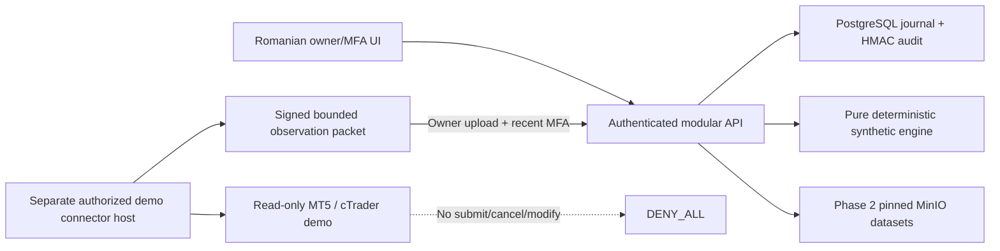
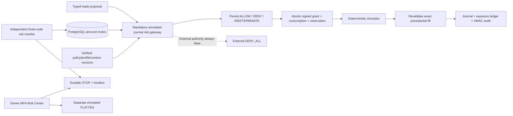

# Architecture — Phase 6

The local application remains SIMULATED with DENY_ALL. It now has authenticated, persistent
management APIs and a proposal-only private AI gateway. There is no trading executor or generated-code
runner. Real inference and browser acceptance remain open; local AI services/boundaries are verified; see
[AI architecture](../AI_GATEWAY_ARCHITECTURE.md) and [evidence](../PHASE6_COMPLETION_REPORT.md).
Phase2 imports/ECB reads remain available.

## Implemented control plane

`apps/api/main.py` composes public health/safety/overview routes, `apps/api/identity` and
`apps/api/governance`. Public status is retained for Phase 0 compatibility; management reads and
writes require an active PostgreSQL session and completed MFA. The API version stays 0.1.0;
overview.phase is now 6. The legacy safety.read_only flag describes trading capability, not metadata
writes. Both execution POSTs always return 403 independently of identity and configuration.

Identity uses Argon2id passwords, encrypted TOTP seeds, one-use hashed recovery codes, persistent
rate buckets and opaque random cookies stored only as SHA-256 hashes in PostgreSQL. Cookies are
HttpOnly and SameSite=Strict. Secure defaults true; only the loopback HTTP development configuration
sets it false. Unsafe requests require an exact allowed Origin and a session-bound HMAC CSRF token.
MFA challenge sessions expire after five minutes; full sessions default to eight hours with a
30-minute idle limit. Enrollment, login MFA and reauthentication rotate session IDs. Password/recovery/
role changes revoke sessions. Sensitive owner actions require MFA within five minutes.

Owner bootstrap serializes on security_state and requires a generated private token. OWNER can
create OPERATOR/VIEWER identities and manage authorization; the initial owner cannot be demoted or
disabled through the API. Each domain record belongs to one user. An owner role does not bypass
another user's record partition. VIEWER can read its own records but cannot mutate them. There is
no shared-account delegation. Phase6 adds an AI-only bounded authenticated stream and wait read,
with session revalidation and released authentication locks. It grants no trading capability.

## Persistence and transaction boundaries

`packages/persistence/models.py` defines users, roles, sessions, recovery codes, rate buckets,
accounts, broker metadata, venues, instruments, firms/programs, policy versions, risk profiles,
strategies/versions, experiment metadata, review requests, incidents and audit events. Scoped UUID
identities and composite foreign keys enforce matching record ownership. Numeric columns preserve
money to eight decimal places and percentages to four. APIs accept decimal strings and reject floats.

Migration `0002_identity_governance` adds these tables after the preserved `0001_foundation`.
Frozen Alembic operations support up/down/up on disposable PostgreSQL; development is upgraded
only. `scripts/migrate_runtime.py` uses the migration identity, then provisions `research_app`.
The API receives only this restricted runtime DSN. It refuses identity service with superuser,
create-role/create-database or audit rewrite privileges. Admin/migration credentials are not passed
to the API container. The private development .env is still inside the trusted host boundary.

`packages/persistence/store.py` provides bounded connections and transactions. Explicit repositories
in governance/routes.py enforce ownership/reference checks, immutable references and optimistic
revision checks. User/record locks serialize critical mutations; the audit-head row serializes events.
Business state and its success audit event commit together or both roll back. Login/MFA rejection
records and rate counters deliberately commit even when authentication fails.

Audit events contain ordered sequence/UUID, UTC time, actor/role/MFA context, entity/correlation IDs,
public before/after metadata and previous/current HMAC-SHA256 digests. Runtime privileges and database
triggers deny event UPDATE/DELETE/TRUNCATE. Strategy versions are likewise immutable. Policy triggers
allow only verification metadata/revision changes; content requires a new version. Chain verification
checks events against the durable head. This protects against application-role rewrites and detects
tested administrator tampering, but a host/DB administrator holding the HMAC key is trusted. There
is no independent external anchor, production retention job or full decision-replay engine.

## Policy and research metadata

Bootstrap creates only the names FTMO, FundedNext and The5ers. Programs and policies are entered by
the user, with sources, document digest, aware effective/expiry times and exact account/program scope.
Source URLs reject credentials, query strings and fragments. A policy captures account/program
revisions. Missing, unverified, expired, future-dated or changed-scope policies fail eligibility;
only the latest version counts. Owner verification is a recorded human attestation, not automated
source validation or a legal permission. The response always says trading_authorized=false.

Risk percentages are configuration, not enforced exposure limits. Strategy digests do not establish
that code exists or is safe. Experiments are records, not executed experiments. Approval requests
support PENDING/REVIEWED/REJECTED only; REVIEWED never creates executor authority. Broker connections
contain adapter names/account IDs only, with no credential fields or network calls.

## React and deployment

`apps/web/src/Management.tsx` adds Romanian bootstrap/login/MFA/recovery, account/risk editing,
firm/program/policy entry and verification, owner user management, session/password controls and audit
views. Fetches use real same-origin API routes; generated OpenAPI TypeScript contracts and input
schemas define the data. Passwords/codes are cleared after use; CSRF state remains in memory, and
no authentication token is put in localStorage. Existing health polling, outage reporting, theme,
mobile navigation and reference displays remain. `management-locale.ts` extends Romanian labels;
a complete English translation is not implemented.

Compose runs PostgreSQL, Redis, MinIO, a one-shot migration service, API and unprivileged Nginx.
Host ports remain 127.0.0.1. Internal control traffic and host-facing bridge networks are separate.
API/web use non-root users, read-only roots, capability drop and no-new-privileges. Development data
volumes are persistent. Disposable integration projects use their own bridge, temporary credentials,
dynamic loopback ports and unique volumes; bindings/TCP are checked before and after restart.
The test harness removes only its own project. Browser tests use separate databases per viewport.

## Future boundaries — not implemented

Phases2–5 data, simulated execution/risk and trusted quantitative research are implemented below.
Broker-capable independent signing/execution, research VM/microVM isolation, AI scheduling, paper
execution and external operational replay remain future modules. Research must never receive broker/
deployment credentials, Docker sockets, hostile host mounts or authority to rewrite auth/governance/
risk/executor code. Ordinary Compose isolation is not proof of a safe hostile-code sandbox.

## Phase 2 implemented data subsystem

`packages/market` supplies typed import/row contracts, registered provider adapters, UTC/DST and
point-in-time operations, streaming quality checks, Parquet processing, immutable object access and
fenced ingestion jobs. `apps/api/market` exposes authenticated management/query endpoints and request/
query quotas. Existing Phase 1 identity/ownership/audit boundaries are reused; data jobs are trusted
fixed application code, not the prohibited generated-code worker.

Migration `0003_market_data` adds market_providers, market_datasets and ingestion_jobs. Composite
owner foreign keys bind provider/account/instrument/dataset references. Dataset versions serialize
under a provider lock; input+spec hashes deduplicate requests. Published metadata is immutable through
DB triggers, and the runtime cannot DELETE/TRUNCATE datasets. Success publication and its audit event
commit together after every artifact and manifest has been written. A partial attempt never becomes
usable. Failed attempts may leave unreachable retained objects; cleanup/retention accounting remains
an operational concern rather than unsafe deletion of published data.

MinIO has an object-lock-enabled, versioned market-data bucket. Migration-time root credentials
create a scoped service user with pinned-version read/write/retention rights and no delete/admin
permission. API/data-worker containers never receive MinIO root or PostgreSQL admin credentials.
Objects have COMPLIANCE retention (default 30 days, configurable 1..3650); protected retention cannot
be shortened for an existing version. Application credentials cannot delete versions after expiry
either. Immutable version IDs and SHA-256, rather than a mutable latest-key lookup, identify inputs,
raw Parquet, normalized/derived Parquet and manifests. Root deletion during protection is tested.
This remains a trusted-host development deployment, not an independent archival/backup service.

Partitions encode provider, instrument, data type, dataset/attempt, UTC month and layer. Raw uploaded
bytes are retained exactly; raw Parquet stores source-row payloads, and normalized Parquet stores
UTC plus original timestamp/zone, availability/publication/observation, source sequence/vintage and
exact decimal values. Corrections/aggregations create new artifacts. Zstandard row groups contain at
most 10,000 rows. Imports cap input at 20 MiB, rows at one million, Parquet declared uncompressed
payload at 128 MiB and cells/columns at bounded sizes. Duplicate detection spills to a disk-backed
SQLite BLOB-key index. The worker has a 512 MiB memory limit and 128 MiB temporary filesystem.
Multi-year/tick archives must be split into bounded source files/jobs; no monolithic unbounded upload.

PostgreSQL is the durable job outbox. Redis persistent list messages are bounded wakeup hints;
missing hints are recovered by DB polling. Two PostgreSQL advisory-lock slots limit data workers per
database; row claims use SKIP LOCKED, 90-second leases, heartbeats and worker-token fencing. Failed
attempts use exponential backoff (including provider Retry-After), up to three normal attempts.
Queued/running cancellation and current owner/account authorization are checked before publication.
A real killed-worker/expired-lease recovery test passes. Byte-range source download resumption is
not advertised; current adapters do not support it. Processing restarts from a pinned complete input.

The adapter registry has LOCAL CSV/Parquet, MT5_EXPORT files, ECB daily reference rates and a blocked
premium extension point. New trusted adapters implement the provider protocol; no user-specified
Python module or arbitrary HTTP endpoint is loaded. ECB egress is a fixed HTTPS origin/series allowlist,
without redirects, broker credentials, fabricated cross rates, OHLC, spread or volume. Its dates are
reference-day buckets; availability is conservatively the actual download time because historical
release vintages are not established. The optional MT5 exporter is a separately invoked, explicitly
authorized Windows-terminal reader; actual terminal connectivity remains BLOCKED/unverified here.

Queries authorize owner/account before object access, verify manifests/part hashes, prune partitions
and read bounded batches. Two expensive queries per API process, 100,000 scanned rows and at most
2,000 JSON records bound consumption. The API has a 768 MiB limit and private 64 MiB upload tmpfs.
An eight-object cache is keyed by pinned version/hash. Historical queries require decision timestamps;
prices/releases observed/published/available later are excluded. Optional per-dataset sequence cutoffs
exclude later same-instant observations. Without a cutoff, a timestamp means the end of that instant.
As-of joins require VALID datasets in one account partition. DEGRADED is available only for explicitly
labeled human preview; REJECTED never supplies research samples. Future release values are never
backdated. A proactive future-calendar scheduling/blackout service remains unimplemented.

`MarketData.tsx` adds real API provider/instrument registration, import/download jobs, progress/cancel,
coverage/version/quality/provenance inspection and bounded interactive price samples. Authentication
is reused from Management. CSV fixtures remain SYNTHETIC_TEST_FIXTURE; real ECB rows are PUBLIC_PROVIDER;
user files are USER_SUPPLIED. The chart uses approximate display coordinates while tables retain
exact decimal strings. Browser workflow acceptance remains blocked by macOS launch permissions.

## Phase 3 broker and simulator boundary

`apps/api/execution` extends the authenticated modular monolith with BrokerRuntime (an extension of
existing BrokerConnection), SimulationRun, immutable SimulationCommand/ExecutionEvent and immutable
BrokerObservation. Additive Alembic revision 0004_execution_journal preserves prior schemas and data.
The primary API holds no broker secret and cannot contact a broker through an adapter. Research code
has no runner. The optional bridge is excluded from the primary Docker image; its SDK import is
Windows-only. Shared domain/serialization/validation contracts have no API identity or SDK imports.

Engine commands and audit append commit under a locked run in one PostgreSQL transaction. Idempotent
receipts remain compact, while state integrity is bound to a contiguous event hash chain. UNKNOWN
requires explicit reconciliation against durable synthetic truth. Restart, process SIGKILL and
concurrent duplicate processing are tested against disposable real services. Main local schema is
0004; runtime cannot rewrite journal commands/events/observations. No independent risk gateway,
external execution outbox, exactly-once broker guarantee or generated-code isolation is implemented.

The separate bridge uses private-file credentials, loopback mTLS plus bearer authentication,
Ed25519 signed observations and a bounded child read process. OAuth browser callback uses mTLS plus
one-use state. MT5 Windows SCM/Job/ACL and actual broker connectivity remain untested. Central
observation synchronization is manual snapshot import, not autonomous polling. Read
[BROKER_ADAPTERS.md](BROKER_ADAPTERS.md), [EXECUTION_SIMULATOR.md](EXECUTION_SIMULATOR.md) and
[ORDER_STATE_MACHINE.md](ORDER_STATE_MACHINE.md) for contracts, bounds and limitations.

## Phase 4 enforced simulated risk boundary — 2026-10-27

This section supersedes the Phase 3 statements that no risk gateway/ledger exists. Migration
0005_risk_gateway adds ten tables; original tables and migrations remain intact. packages/risk separates
strict contracts, payoff/FX sizing, versioned policy selection, account projection/drawdown ledger,
HMAC authorization, reservations, gateway and independent monitoring. apps/api/risk exposes owner-MFA
configuration and emergency actions plus authenticated account reports and non-authoritative what-if.

Every new durable entry passes gateway assessment, signature/consumption and atomic allocation under
account-before-run locks. Actual fill price/context is independently reevaluated. Existing pure Engine
math is not a privileged database order API. Direct durable calls without the private service identity
refuse. UNKNOWN allocations remain held. SQL protects immutable grants/uses/decisions/profile/context/
ledger/emergency records and policy content. STOP survives restart; FLATTEN never reports external closure.

The risk-monitor container uses fixed trusted code, restricted DB identity and private HMAC key only,
no published port, control-network-only bridge, no broker/MinIO/admin/bootstrap secrets, no Docker socket,
read-only root and bounded CPU/memory/pids/tmpfs. Its real heartbeat must be fresh for new admissions;
financial freshness uses the explicit synthetic account clock rather than falsely treating historical
simulation time as live. Calendar inputs are explicit synthetic evidence, not a connected future feed.

Current gateway/signing code shares the trusted control host/API private key; separate process
monitoring does not make this an independently secured external broker executor. External signing
identities, broker-side capability verification, real margin/tradability, host-admin-resistant anchoring,
production restore/load acceptance and generated-code isolation remain separate unimplemented gates.
RiskCenter/RiskBanner are real Romanian APIs/UI; managed browser acceptance is separately reported.
See RISK_CALCULATIONS.md, RISK_AUTHORIZATION_PROTOCOL.md and PHASE4_COMPLETION_REPORT.md.

## Phase 5 — trusted quantitative research

The reviewed strategy registry proposes typed signals from available observations. PyArrow screening
is exploratory; the event engine delegates every simulated submit/fill to the existing journal and
Phase 4 gateway. Each trial/fold/attempt has its own account/clock and frozen, explicitly approved source
policy/profile assumptions. Source balances and ordinary journals remain separate. Intrabar ambiguity,
missing financial evidence, stale quotes, incomplete liquidation and configuration revocation fail closed.

Seven additive 0006 tables retain plans, jobs, hypotheses, results, seals, releases and internal account
bindings. Durable workers use PostgreSQL leases, fencing and two advisory slots; MinIO stores immutable
versioned/checksummed results. A cancelled/fenced/crashed attempt cannot publish an accepted partial
result. Semantic digests compare financial outputs independently of operational UUIDs. Each accepted
manifest pins the fixed software/runtime, strategy, data, costs, risk and chronology.

The fixed research worker has no public port, broker/admin/bootstrap credentials, Docker socket or
untrusted code input. It shares the trusted control-plane signing domain; it is not a hostile-code
sandbox or independent external executor. CPU/memory/PID/time/row/trial/artifact quotas are explicit.
Owner-MFA APIs protect mutations and one-use frozen holdout release. Ordinary data APIs exclude sealed
owner intervals and aliases; prior exposure/independent custodian secrecy remain unknown/unimplemented.

See STRATEGY_FRAMEWORK.md, BACKTEST_ENGINE_SPEC.md, STATISTICAL_VALIDATION.md,
BIAS_AND_LEAKAGE_PREVENTION.md and EXPERIMENT_REPRODUCIBILITY.md. Current exact acceptance:
[../PHASE5_COMPLETION_REPORT.md](../PHASE5_COMPLETION_REPORT.md). No Phase 6 or paper/live promotion.

## Phase 5.5B — frontend architecture migration

App mounts shared AuthProvider, native typed task routing and scoped safety independently of public
overview. Five primary destinations replace module peers. Guided research/data reuse existing APIs;
readable stored results retain exact metrics/provenance and disclose sampled charts. Descriptive and
enforced risk remain separate. Native consequence dialogs preserve actual owner-MFA/backend checks.
New owner-scoped import-job lookup and persisted cancel-request read flags are additive only; no new
financial engine, schema migration or external execution capability. See [frontend details](FRONTEND_UX.md),
[coverage](ux-migration-coverage.md) and [acceptance report](../PHASE55B_COMPLETION_REPORT.md).
Current browser and manual accessibility acceptance is BLOCKED, not certified from source inspection.

## Phase 7A bounded research coordinator

`packages/campaigns`, `apps/api/campaigns`, Alembic0008 and the optional `campaigns` Compose profile
add durable research coordination. PostgreSQL locks/leases and immutable campaign/run links reuse
existing Phase5 queue submission, simulator/Risk Gateway and canonical MinIO results. Phase6 retains
inference, model verification, encrypted prompts and restricted context/worker identities. The
coordinator never submits with fabricated user authority: exact owner-reviewed plans and authenticated
model handoffs are explicit pauses. Additive Phase5 deadline/cancellation checks and the restricted
AI boolean authority view protect child work when the coordinator is offline. Research source/code,
account, policy, dataset and model revisions remain revocable. No new financial engine or SQL grants
to inference workers. See [full architecture](../AUTONOMOUS_RESEARCH_ARCHITECTURE.md),
[lifecycle](../RESEARCH_CAMPAIGN_LIFECYCLE.md), [evaluation](../RESEARCH_EVALUATION_POLICY.md) and
[security boundaries](../RESEARCH_SECURITY_BOUNDARIES.md). Native foundation acceptance is distinct
from browser/manual, real-model, real-historical-data and scalable-backtesting gates. No Phase7B.

## Explicit OpenRouter integration follow-up — 2026-10-28

The existing AI worker/compatible adapter now supports an exact OpenRouter destination behind
separate operator opt-in, immutable owner cloud authorization, encrypted write-only credential,
explicit per-request cost consent and atomic spend reservations. Migration0009 extends only AI
storage. Private providers, MFA/context isolation, risk/backtest math and campaign budgets remain.
The CONNECT proxy validates/pins public DNS only for the exact approved hostname; no unrestricted
URLs or model tools are added. Public inference is disabled by default and has not been deployed or
called here. Read [implementation, setup and acceptance limits](../OPENROUTER_INTEGRATION_REPORT.md).
