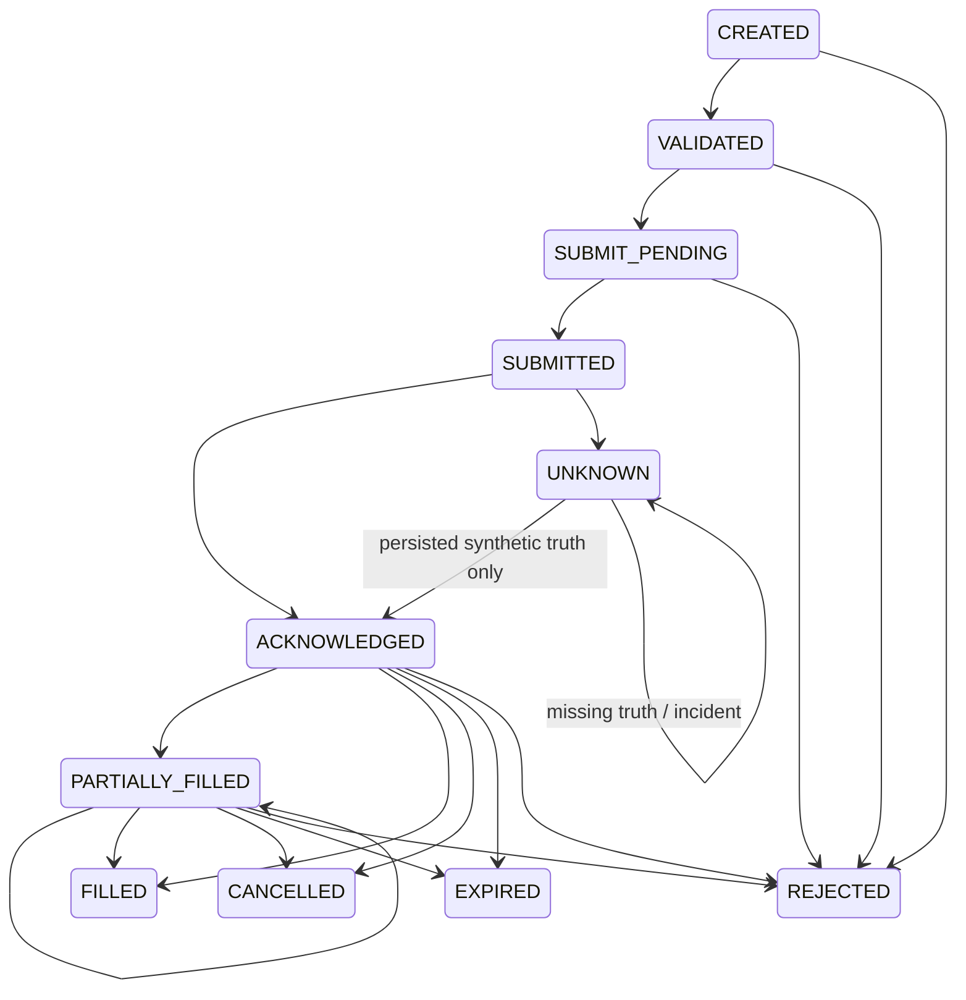

# Order state machine and durable receipt

Implementation: `packages/execution/engine.py`, `journal.py`, `models.py` and
`migrations/versions/0004_execution_journal.py`. All executable lifecycle events are SIMULATED.

Normal transitions can be recorded in one command transaction. Orders retain requested volume,
side/type/price/protection, internal ID, command idempotency key, optional owned strategy version,
modeled broker ID, source sequence/timestamps, reason and cumulative exact fills. Run associations
provide owned account/connection/instrument identity. Position and fill changes are event-journaled.

The caller locks the owned SimulationRun row. Journal verification checks the current chain/state,
then checks `(run_id,key)` uniqueness and canonical request digest. Same key and same request never
re-executes; a changed payload is a conflict. The response combines current authoritative state/head
with `original_receipt`, a compact immutable receipt of the first command. A retry after later
commands need not return historical full state. Clients must inspect receipt and current state.

Each command appends ordered events and STATE_COMMITTED containing the final state/request digest.
The chain covers run ID, sequence, correlation, virtual time, payload and previous hash. The mutable
snapshot must match the final state digest. Command receipt, event batch, snapshot and existing
HMAC audit append commit in one PostgreSQL transaction. Runtime grants and triggers prohibit
UPDATE/DELETE/TRUNCATE on events, commands and observations. Integrity failure refuses execution.

Real process SIGKILL tests cover before/after commit; restarting and retrying a command yields one
committed synthetic fill. Concurrent processors serialize and deduplicate at the row lock. Actual
PostgreSQL restart tests preserve the journal. These tests do not prove exactly-once broker delivery.
There is no external order transport or external execution outbox in this release.

Before-submit disconnection is a known refusal. Submit-before-ack/delayed acknowledgement creates
UNKNOWN and blocks blind resubmission/cancellation. Reconciliation reads stored synthetic broker
truth; if unavailable, it leaves UNKNOWN and an incident. External observations are separately
signed, identity-scoped, sequenced and immutable. Missing sequences or changed order/position truth
raise uncertainty. They do not resolve an actual submitted order because no such order can be sent.

Host/DB administrators and the application HMAC key remain trusted. Hash/HMAC chains plus database
grants are not an independent external audit anchor or protection from a fully compromised host.
